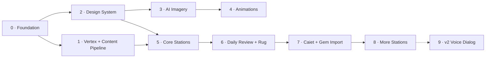

# Miorița: Product Backlog

> **Version**: 0.1.0 · **Date**: 2026-10-25 · **Status**: DRAFT
> **Estimation**: Fibonacci (1, 2, 3, 5, 8, 13)
> **Traceability**: [requirements.md](requirements.md) · [design.md](design.md) · [art-direction.md](art-direction.md)

## Definition of Done
1. ✅ `tsc --noEmit` strict, ESLint clean, `vitest run` green
2. ✅ `npm run content:lint` green (audio present, comma-below ș/ț, hints ≤2 sentences)
3. ✅ Touch targets ≥48px; works at 1920×1200 on Tab A9+
4. ✅ Reduced-motion verified for any new animation
5. ✅ Romanian text approved by Florin

## Roadmap at a glance

> [!TIP]
> Phases 3–4 (art) can run in parallel with Phases 1 and 5. Placeholder SVG shapes keep code work unblocked until the final art lands.

---

# Phase 0: Foundation  *(≈1 evening)*

| Task | Description | Pts | Traces |
|---|---|---|---|
| T-0.1 | Scaffold Vite vanilla-ts, strict tsconfig, ESLint/Prettier (copy configs from Clawey) | 2 | CON-001 |
| T-0.2 | PWA manifest + service worker (port Clawey `sw.js`), offline shell | 2 | NFR-PWA-001 |
| T-0.3 | Router + screen shell (map, station, stâna, parent) | 3 | FR-MAP-001 |
| T-0.4 | IndexedDB layer + D1 delta sync (port Clawey `storage/` + `functions/api/sync`) | 5 | design §3.2 |
| T-0.5 | Vitest + Playwright with Tab A9+ profile; GitHub Actions CI | 3 | DoD |

**Total: 15**

---

# Phase 1: Vertex AI & Content Pipeline  *(≈2 evenings)*

### Story 1.1: Vertex connectivity
| Task | Description | Pts | Traces |
|---|---|---|---|
| T-1.1.1 | Run setup commands (design §2.1); add `.env.local.example` | 1 | NFR-AI-001 |
| T-1.1.2 | `scripts/lib/vertex.ts` + `scripts/vertex.config.ts` (model IDs) | 2 | CON-004 |
| T-1.1.3 | `npm run vertex:ping`: one text call + one TTS call, prints model and latency | 1 | — |

### Story 1.2: Content model
| Task | Description | Pts | Traces |
|---|---|---|---|
| T-1.2.1 | `content/taxonomy.json` (10 categories with descriptions, bridge notes) | 2 | FR-TAX-001/002 |
| T-1.2.2 | Zod schema for `Item`; `content:lint` script | 3 | FR-CONT-001 |
| T-1.2.3 | `content/lexicon.json`: ~150 nouns relevant to Tudor (school, football, family, food, animals, Minecraft) with gender + plural, **written by Florin** | 3 | FR-ST-GEN |
| T-1.2.4 | Hand-write 10 seed items per Must category (GEN, ART, CAS, CLQ) as few-shot examples | 3 | CON-005 |

### Story 1.3: Draft → review → audio
| Task | Description | Pts | Traces |
|---|---|---|---|
| T-1.3.1 | `content:draft` with structured JSON output, using seed items as few-shot examples | 5 | FR-CONT-002 |
| T-1.3.2 | `/dev/review` page: approve/edit/reject drafts, play audio, keyboard shortcuts | 5 | FR-CONT-003 |
| T-1.3.3 | `content:audio`: TTS per approved item part, idempotent, writes meta | 3 | FR-CONT-004, FR-AUD-001 |
| T-1.3.4 | A/B voice listening page; choose Miorița's voice | 1 | Open Q3 |

**Total: 29**

---

# Phase 2: Design System  *(≈2 evenings)*

| Task | Description | Pts | Traces |
|---|---|---|---|
| T-2.1 | `src/styles/tokens.css` (design §4.2) + base styles, linen background | 2 | design §4 |
| T-2.2 | Font selection + `/dev/glyphs` diacritics test page | 2 | NFR-TYPE-001 |
| T-2.3 | Motif grid format + SVG renderer + 7 starter motifs | 5 | design §4.4 |
| T-2.4 | Core components: `MioritaBubble`, `StitchBand`, `ChoiceCards`, big buttons | 5 | design §5 |
| T-2.5 | Web Audio synth: wooden tick, bell, soft "try again" (no buzzers) | 2 | FR-FB-004 |

**Total: 16**

---

# Phase 3: AI Imagery 🎨  *(art-direction.md Part A)*

| Step | Task | Pts | Output |
|---|---|---|---|
| A0 | `art:image` script: prompt YAML + style-bible prefix + reference images + meta sidecars | 3 | `scripts/art/` |
| A1 | **Style exploration**: 4 variants, pick the reference | 2 | `art/refs/style.png` |
| A2 | **Mascot sheet** + expressions sheet (iterate until consistent) | 3 | `art/refs/miorita-*.png` |
| A3 | **Village map hero** 1920×1200 + 2560×1600 | 3 | `public/art/map.*` |
| A4 | **9 station illustrations** | 5 | `public/art/stations/*` |
| A5 | **Collectibles** (9 stickers) | 2 | `public/art/zestre/*` |
| A6 | **Textures** (linen, paper, walnut) | 1 | `public/art/tex/*` |
| A7 | **App icon + splash** (incl. maskable) | 1 | `public/icons/*` |
| A8 | Hand-made SVG: ribbons, icons, bands | 3 | `src/assets/svg/*` |
| A9 | `art:optimize` + manifest + size budget check | 2 | `public/art/manifest.json` |

**Total: 25**

---

# Phase 4: Animations ✨  *(art-direction.md Part B)*

| Step | Task | Pts | Output |
|---|---|---|---|
| N1 | **Micro-interactions**: squash, wobble, flip, stitch reveal, rug weave-in | 3 | CSS/SVG |
| N2 | **Ambient village loop** (Veo from A3) + seamless trim + WebM/MP4 | 3 | `public/art/map.webm` |
| N3 | **Mascot reaction clips** ×4 (Veo, chroma key → VP9 alpha) | 5 | `public/art/miorita-*.webm` |
| N4 | Station ambient touches (SVG first, Veo if needed) | 2 | — |
| N5 | **Reward moment** choreography (stitch, cheer, chime) | 2 | FR-REW-002 |
| N6 | `art:video` script + reduced-motion posters + off-screen pause | 3 | NFR-PERF-002 |

**Total: 18**

---

# Phase 5: Core Stations (Must)  *(≈4 evenings)*

| Story | Station | Key tasks | Pts | Traces |
|---|---|---|---|---|
| 5.0 | Session engine | Shared session contract (≤8 items, ≤5 min, retry once, correct audio last, results to `attempts`) | 5 | NFR-UX-003, FR-FB-001/003 |
| 5.1 | **Grădina cu Genuri** | `SortBaskets` drag/tap, un/două test audio, 30+ approved items | 5 | FR-ST-GEN |
| 5.2 | **Moara cu Articole** | Mill animation, `ChoiceCards`, preposition-rule items | 5 | FR-ST-ART |
| 5.3 | **Podul „A cui? Cui?"** | `TileBuilder`, plank-laying animation, *la*→genitive/dative items | 8 | FR-ST-CAS |
| 5.4 | **Vânătorul de Englezisme** | `CalqueCatcher` tappable words, catch → choose fix | 5 | FR-ST-CLQ |
| 5.5 | Podul englez toggle | Contrastive note drawer per item | 2 | FR-FB-002 |

**Total: 30**

---

# Phase 6: Daily Review & Rug  *(≈2 evenings)*

| Task | Description | Pts | Traces |
|---|---|---|---|
| T-6.1 | Leitner scheduler (1/3/7/14/30), unit-tested | 3 | FR-SRS-001 |
| T-6.2 | Stâna daily review (≤5 items, ≤3 min, weighted towards recent Caiet categories) | 3 | FR-SRS-002/003 |
| T-6.3 | `RugCanvas`: rug grows with stitches; motif rows on mastery | 5 | FR-REW-001/002 |
| T-6.4 | Map mastery bands + "review due" bell | 2 | FR-MAP-002/003 |

**Total: 13**

---

# Phase 7: Caiet & Gem Bridge  *(≈2 evenings)*

| Task | Description | Pts | Traces |
|---|---|---|---|
| T-7.1 | Parent PIN gate + Caiet quick-log form (said / correct / category chip) | 3 | FR-CAIET-001 |
| T-7.2 | Keyword rules to auto-suggest category (*la* + noun → CAS, *sunt N ani* → CLQ…) | 2 | FR-CAIET-001 |
| T-7.3 | Caiet entry → personal item → SRS priority | 3 | FR-CAIET-002 |
| T-7.4 | Gem JSON import (paste → validate → preview → add) | 3 | FR-CAIET-003 |
| T-7.5 | Weekly parent card (top 3 categories, trends, dinner recasts) | 3 | FR-CAIET-004 |

**Total: 14**

---

# Phase 8: More Stations (Should/Could)

| Station | Pts | Traces |
|---|---|---|
| Fântâna cu Al-A-Ai-Ale | 3 | FR-ST-POS |
| Ecoul din Munte | 5 | FR-ST-CLI |
| Poteca lui Să | 5 | FR-ST-SUB |
| Târgul de Numere | 3 | FR-ST-NUM |
| Atelierul de Culori | 5 | FR-ST-AGR |
| "Spune tu!" mic button (Web Speech ro-RO) | 3 | FR-AUD-003 |
| Lada de zestre collectibles | 2 | FR-REW-003 |

**Total: 26**

---

# Phase 9: v2 "Povestește-mi" Voice Dialog *(Won't, v1)*

Parked. Prerequisites: Gem experiment results; Cloud Run service with attached service account; push-to-talk → Gemini audio-in → JSON `{verbatim, reply, corrections[]}`; corrections feed the Caiet automatically.

---

## Totals

| Phase | Points |
|---|---|
| 0 Foundation | 15 |
| 1 Vertex + Content | 29 |
| 2 Design System | 16 |
| 3 AI Imagery | 25 |
| 4 Animations | 18 |
| 5 Core Stations | 30 |
| 6 Review + Rug | 13 |
| 7 Caiet + Gem | 14 |
| **MVP (0–7)** | **160** |
| 8 More Stations | 26 |
