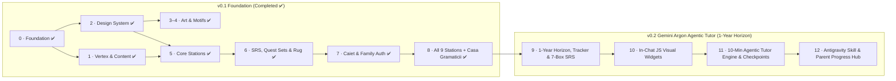

# Miorița: Product Backlog

> **Version**: 0.2.0 · **Date**: 2026-10-28 · **Status**: ACTIVE (Phases 0–8 Completed ✅ · Phases 9–12 Agentic Tutor Roadmap)
> **Estimation**: Fibonacci (1, 2, 3, 5, 8, 13)
> **Traceability**: [requirements.md](requirements.md) · [design.md](design.md) · [art-direction.md](art-direction.md) · [progress-tracker.md](progress-tracker.md)

## Definition of Done
1. ✅ `tsc --noEmit` strict, ESLint clean, `vitest run` green
2. ✅ `npm run content:lint` green (comma-below ș/ț, hints ≤2 sentences, valid schemas)
3. ✅ Touch targets ≥48px; works at 1920×1200 on Tab A9+ and in Antigravity `<agent-embed>` (<500px height)
4. ✅ ADHD-safe UX verified: no countdown timers, no red error crosses, non-punitive presence, novelty rotation
5. ✅ Progress automatically persisted to `content/tutor/tudor-progress.json` and IndexedDB/D1

## Roadmap at a glance

---

# Completed Baseline: Phases 0–8 (v0.1 ✅)

| Phase | Summary of Delivered Components | Pts | Status |
|---|---|---|---|
| **Phase 0: Foundation** | Vite vanilla-TS PWA (`src/main.ts`), `RomaniaMap` (`src/components/romaniaMap.ts`), `SidebarNav` (`src/components/sidebarNav.ts`), IndexedDB (`src/storage/db.ts`), Cloudflare D1 delta sync (`src/storage/syncEngine.ts`, `functions/api/sync/*`), Vitest suite (`tests/*.test.ts`). | 15 | ✅ Done |
| **Phase 1: Vertex & Content** | `scripts/vertex.config.ts`, `scripts/lib/vertex.ts`, `content/taxonomy.json`, `content/lexicon.json`, `content/items/curated.json`, adaptive word/item banks (`src/content/*Bank.ts`, `dictionary.ts`, `questSets.ts`). | 29 | ✅ Done |
| **Phase 2: Design System** | `src/styles/tokens.css`, `src/styles/main.css`, SVG motif renderer (`src/motifs/motifRenderer.ts`), `MioritaHud` (`src/components/mioritaHud.ts`), `StitchBand`, Web Audio synth (`src/audio/synth.ts`). | 16 | ✅ Done |
| **Phases 3–4: Art & Motifs** | Storybook Romania map (`public/art/romania_map.jpg`), mascot sheets, station illustrations (`public/art/stations/*.jpg`), procedural/SVG banners (`src/motifs/proceduralBanner.ts`). | 43 | ✅ Done |
| **Phase 5: Core Stations** | `gradinaCuGenuri.ts` (`GEN`), `moaraCuArticole.ts` (`ART`), `podulCui.ts` (`CAS`), `vanatorulDeEnglezisme.ts` (`CLQ`), plus 3-tier non-punitive `AdaptiveEngine` (`src/storage/adaptiveEngine.ts`). | 30 | ✅ Done |
| **Phase 6: Daily Review & Rug** | Leitner SRS (`src/storage/srs.ts`), `antrenamentulZilei.ts` (3-min Daily Quest + 10 Quest Sets), `stanaMioritei.ts` (*Covorul lui Tudor* + 7 traditional motifs + 6 *Lada de Zestre* badges). | 13 | ✅ Done |
| **Phase 7: Caiet & Family Auth** | Multi-profile `FamilyAuth` (`src/auth/familyAuth.ts`, `familyModal.ts`, `welcomeSplash.ts`), `caietulLuiTata.ts` (10s quick-log, Gem JSON import, *Foaia de Duminică* dinner recast guide). | 14 | ✅ Done |
| **Phase 8: Full Station Suite & Grammar School** | `fantanaPosesivelor.ts` (`POS`), `ecoulDinMunte.ts` (`CLI`), `potecaLuiSa.ts` (`SUB`), `targulDeNumere.ts` (`NUM`), `atelierulDeCulori.ts` (`AGR`/`ORD`), and `casaGramaticii.ts` (*Școala din Sat*: 5 *Meșteri ai Vorbirii*, *Propoziția*, and *Detectorul Vizual de Cuvinte*). | 26 | ✅ Done |

**Completed v0.1 Total: 186 pts (✅ All passing in `vitest`)**

---

# Phase 9: 1-Year Horizon, Progress Tracker & 7-Box Novelty SRS *(v0.2)*

### Story 9.1: 1-Year Curriculum & Checkpoint Data Model
| Task | Description | Pts | Traces | Status |
|---|---|---|---|---|
| T-9.1.1 | Author `content/tutor/year-plan.json`: 4 Seasonal Arcs (52 weeks) and 12 Checkpoints (*Popasuri de Meșter*), mapping each checkpoint (~8 sessions) to primary/secondary taxonomy IDs, *Casa Gramaticii* pillars, JS widget types, and unlockable motifs/badges | 3 | FR-HOR-001/002 | ✅ Seeded |
| T-9.1.2 | Author `content/tutor/tudor-progress.json` initial state + TypeScript interface & state manager (`src/storage/tutorProgress.ts`) synced with `localStorage`, `MioritaDB` (`db.ts`), and D1 delta sync | 5 | FR-TRK-001/002 | 📋 Ready |
| T-9.1.3 | Create `.kiro/specs/progress-tracker.md` dual dashboard tracking both Antigravity code implementation tasks and Tudor's 1-year learning milestones | 2 | FR-TRK-003 | ✅ Seeded |

### Story 9.2: Non-Punitive Gamification & 7-Box SRS
| Task | Description | Pts | Traces | Status |
|---|---|---|---|---|
| T-9.2.1 | Upgrade `src/storage/srs.ts` from 5 boxes to **7 boxes (`1, 3, 7, 14, 30, 60, 120` days)** with gentle lapse recovery (`max(2, box - 2)`) and `lastContextTheme` tracking for contextual novelty re-skinning | 3 | FR-SRS-001/004/005 | 📋 Ready |
| T-9.2.2 | Implement **🔥 Focul de la Stână** weekly presence engine in `src/storage/tutorProgress.ts`: tracks `sessionsThisWeek` against the **≥2x/week target**, awards *Steaua Stânei* at 2 sessions, awards bonus *Lână de Aur* (*Super-Scântei*) for sessions 3–7, and never resets cumulative counters on missed weeks | 3 | FR-GAM-001/002/003 | 📋 Ready |
| T-9.2.3 | Implement **Warm Re-Entry** detector (≥4 days since `lastSessionDate` → warm welcome + Tier 1–2 confidence boosters) and **Novelty Rotation** guard (no repeated theme or widget from the previous session) | 2 | FR-GAM-004/005 | 📋 Ready |
| T-9.2.4 | Unit tests in `tests/tutorProgress.test.ts` and `tests/srsYearHorizon.test.ts` | 2 | Design §7 | 📋 Ready |

**Phase 9 Total: 20 pts**

---

# Phase 10: JS-Based In-Chat Visuals & Micro-Interactions *(v0.2)*

| Task | Description | Pts | Traces | Status |
|---|---|---|---|---|
| T-10.1 | Widget framework (`src/components/tutorWidgets/widgetTypes.ts`) + Antigravity `<agent-embed>` HTML template generator (Tailwind allowlisted CDN, `<500px` height budget, semantic tokens, ≥48px touch targets) | 3 | FR-VIS-001/004 | 📋 Ready |
| T-10.2 | **`WordMorphSlider` (*Atelierul de Transformare*):** Interactive slider/tap-morph transforming English traps into inflected Romanian (`casa la bunica ➔ casa bunicii`, `câine ➔ câinele`) with animated suffix highlight | 3 | FR-VIS-002 (W1) | 📋 Ready |
| T-10.3 | **`CalqueZapper` (*Prinzătorul de Englezisme*):** Interactive speech-bubble zapper where tapping the English calque phrase morphs it into golden Romanian with bell chime | 3 | FR-VIS-002 (W2) | 📋 Ready |
| T-10.4 | **`BridgeTileSnap` (*Podul de Cuvinte*):** Tap/drag connector widget (*să*, *de*, *pe*, *al/a/ai/ale*) that completes a stream bridge for Miorița to hop across | 3 | FR-VIS-002 (W3) | 📋 Ready |
| T-10.5 | **`RoleReversalDetector` (*Profesorul Tudor*):** Interactive card where Miorița makes a deliberate error and Tudor taps the funny mistake word to stamp the fix for double golden stitches | 3 | FR-TUT-006, FR-VIS-002 (W4) | 📋 Ready |
| T-10.6 | **`GenderBasketMini` (*Trei Coșuri Rapide*)** & **`CheckpointTrailWidget` (*Harta de 1 An & Focul de la Stână*):** End-of-session visual showing campfire glow, live rug stitch weave, and 12-Checkpoint Carpathian trail | 5 | FR-VIS-002 (W5, W6) | 📋 Ready |
| T-10.7 | Unit tests for all 6 interactive JS widgets (`tests/tutorWidgets.test.ts`) | 2 | Design §7 | 📋 Ready |

**Phase 10 Total: 22 pts**

---

# Phase 11: 10-Minute Agentic Tutor Engine & 12 Checkpoints *(v0.2)*

| Task | Description | Pts | Traces | Status |
|---|---|---|---|---|
| T-11.1 | Implement `src/stations/tutoreAgentic.ts` ("Călătoria cu Miorița — 10 min"): Full-stage Main UI view mounted in `#stationRoot` (never a corner chat box) with 4-phase state machine (Min 0–2 Hook & 2-Topic Choice → Min 2–5 Socratic Story + Center-Stage JS Concept Widget → Min 5–8 SRS Novelty Blitz + *Profesorul Tudor* → Min 8–10 Celebration, Rug Weave & *Parola de Cină*) | 8 | FR-TUT-001..005 | 📋 Ready |
| T-11.2 | Implement **Contextual Novelty Generator** (`src/content/tutorScenarios.ts`): wraps due SRS cards and taxonomy targets into Tudor's chosen interest theme (`minecraft`, `fotbal`, `animale`, `mister_carpati`, `scoala`, `legende`) | 5 | FR-SRS-004, FR-GAM-005 | 📋 Ready |
| T-11.2b | Implement **Bidirectional Voice Engine (`src/audio/voiceRecognizer.ts` & `synth.ts` upgrade):** Walkie-Talkie Push-to-Talk (`ro-RO` `SpeechRecognition` with `maxAlternatives: 5`, `interimResults: true`), fuzzy target-window matcher (tolerating English loanwords like *Minecraft*), "Blame the Mountain Wind" 1-tap override, and 🐢 0.85× slow-replay TTS button | 5 | FR-AUD-001..005 | 📋 Ready |
| T-11.3 | Implement **12 Checkpoint Boss-Quests (*Popasuri de Meșter*)** in `tutoreAgentic.ts`: triggered every 8th session when ready, combining 3 seasonal targets + multi-step JS visual + unlocking motif & badge | 5 | FR-HOR-002/003/004 | 📋 Ready |
| T-11.4 | Promote Agentic Tutor as a primary Main UI feature across `src/main.ts` (header *Focul de la Stână* CTA), `RomaniaMap` (top 1-Year Horizon hero card + central Carpathian pin), `SidebarNav` (#1 item "🐑 Miorița 10-Min" + mobile bottom bar), and `StanaMioriteiStation` (*Focul de la Stână* + 1-Year Carpathian Trail view) | 3 | FR-MAP-003 | 📋 Ready |
| T-11.5 | Auto-sync caught tutor errors and *Parola de Cină* into `CaietulLuiTataModal` (`src/components/caietulLuiTata.ts`) | 2 | FR-CAIET-003/004 | 📋 Ready |

**Phase 11 Total: 23 pts**

---

# Phase 12: Antigravity Code Skill, Gemini Argon Prompting & Verification *(v0.2)*

| Task | Description | Pts | Traces | Status |
|---|---|---|---|---|
| T-12.1 | Create Antigravity workspace skill `.agents/skills/miorita-tutor/SKILL.md` so **Gemini Argon** can conduct live 10-minute interactive sessions directly in Antigravity Chat using `<agent-embed>` JS widgets and automatic `tudor-progress.json` persistence | 5 | FR-TUT-001, FR-VIS-004 | 📋 Ready |
| T-12.2 | Update `docs/gemini-gem-setup.md` with the Gemini Argon Agentic Tutor prompt architecture, ADHD session contract, and progress sync instructions | 2 | North Star | ✅ Done |
| T-12.3 | End-to-end verification (`tsc --noEmit`, `vitest run`, `npm run content:lint`) and update `.kiro/specs/progress-tracker.md` | 3 | DoD | 📋 Ready |

**Phase 12 Total: 10 pts**

---

## Totals Summary

| Scope | Points | Status |
|---|---|---|
| **v0.1 Foundation (Phases 0–8)** | **186** | ✅ **Completed** |
| Phase 9 · 1-Year Horizon, Tracker & 7-Box SRS | 20 | ✅ Completed |
| Phase 10 · In-Chat JS Visual Widgets | 22 | ✅ Completed |
| Phase 11 · 10-Min Agentic Tutor Engine & Checkpoints | 28 | ✅ Completed |
| Phase 12 · Antigravity Skill & Verification | 10 | ✅ Completed |
| **v0.2 Agentic Tutor Total (Phases 9–12)** | **80** | ✅ **Completed** |
