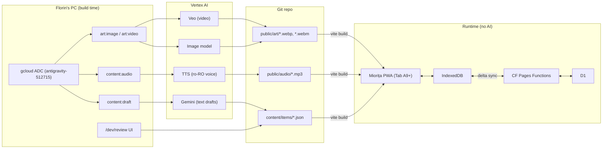

# Miorița: Technical Design

> **Version**: 0.1.0 · **Date**: 2026-10-25 · **Status**: DRAFT
> **Traces to**: [requirements.md](requirements.md)

---

## 1. Architecture



**Key decision: AI runs at build time only.** Every hint, explanation and audio clip is generated on Florin's PC, reviewed, and committed. This gives us:
- **No credentials in the deployed app.** ADC only works locally anyway, and Cloudflare Functions can't use it.
- **No child data sent to AI** (NFR-PRIV-001). This also sidesteps the self-serve API's under-18 restrictions for the app itself.
- **Deterministic, native-approved Romanian.** The LLM never improvises grammar in front of Tudor.
- **Full offline support** and zero runtime AI cost.

> [!NOTE]
> v2 ("Povestește-mi" dialog) will need runtime AI. Plan: a **Cloud Run** service in `europe-west2` with an **attached service account** (no key files) calling Vertex. Clawey's DevOps roadmap already anticipates Cloud Run.

---

## 2. Vertex AI Integration

### 2.1 One-time setup

```powershell
gcloud auth application-default login --project antigravity-512715
gcloud auth application-default set-quota-project antigravity-512715
gcloud services enable aiplatform.googleapis.com texttospeech.googleapis.com --project antigravity-512715
gcloud services list --enabled --project antigravity-512715 --filter="name:aiplatform OR name:texttospeech"
```

### 2.2 SDK & config

- Package: `@google/genai` (unified SDK) in Vertex mode. `@google-cloud/text-to-speech` if using Cloud TTS voices.
- `.env.local` (git-ignored):

```dotenv
GOOGLE_GENAI_USE_VERTEXAI=true
GOOGLE_CLOUD_PROJECT=antigravity-512715
GOOGLE_CLOUD_LOCATION=global          # Gemini text/TTS
VERTEX_MEDIA_LOCATION=us-central1     # Image/Veo models (widest availability)
```

- `scripts/vertex.config.ts` is the **single source of truth for model IDs** (CON-004). Verify current IDs in Vertex AI Model Garden before first use:

| Purpose | Config key | Starting choice (verify) |
|---|---|---|
| Item drafting | `TEXT_MODEL` | Same Gemini Flash family as Clawey (`gemini-3.8-flash`) |
| Illustration (character-consistent) | `IMAGE_EDIT_MODEL` | Gemini image model (supports reference images, so the mascot stays consistent) |
| Illustration (single hero shots) | `IMAGE_GEN_MODEL` | Latest Imagen |
| Animation | `VIDEO_MODEL` | Latest Veo (image-to-video) |
| Item audio | `TTS_MODEL` / `TTS_VOICE` | Gemini TTS, or a Cloud TTS `ro-RO` HD voice (pick by A/B listen) |

```ts
// scripts/lib/vertex.ts (sketch)
import { GoogleGenAI } from '@google/genai';
export const ai = new GoogleGenAI({
  vertexai: true,
  project: process.env.GOOGLE_CLOUD_PROJECT!,
  location: process.env.GOOGLE_CLOUD_LOCATION ?? 'global',
});
export const aiMedia = new GoogleGenAI({
  vertexai: true,
  project: process.env.GOOGLE_CLOUD_PROJECT!,
  location: process.env.VERTEX_MEDIA_LOCATION ?? 'us-central1',
});
```

### 2.3 Scripts

| Script | Does | Output |
|---|---|---|
| `npm run content:draft -- --category CAS --count 20` | Gemini drafts items from the taxonomy + `content/lexicon.json` (Tudor-relevant nouns) | appends `status:"draft"` items |
| `npm run content:audio` | TTS for every approved item part lacking audio | `public/audio/{id}-{prompt\|answer\|hint}.mp3` |
| `npm run art:image -- --id A3` | Runs prompt `A3` from `art/prompts.yaml` (see art-direction.md) | `art/raw/A3-<n>.png` |
| `npm run art:video -- --id N2` | Veo image-to-video from an approved still | `art/raw/N2-<n>.mp4` |
| `npm run art:optimize` | sharp → WebP/AVIF, ffmpeg → WebM/MP4 | `public/art/...` |

Every generated file gets a sidecar `*.meta.json` recording the prompt, model, seed and date, so any asset can be regenerated.

---

## 3. Data Model

### 3.1 Item (content)

```ts
type TaxonomyId = 'GEN'|'AGR'|'ART'|'POS'|'CAS'|'CLI'|'SUB'|'NUM'|'CLQ'|'ORD';

interface Item {
  id: string;                    // "CAS-0007"
  category: TaxonomyId;
  station: StationId;
  mechanic: 'sort3' | 'choose' | 'tiles' | 'gapfill' | 'catch-calque' | 'say';
  promptRo: string;              // "Aceasta este casa ___ ." or the erroneous sentence
  englishShape?: string;         // the interference form, e.g. "casa la bunica"
  answer: string;                // "casa bunicii"
  accepted?: string[];           // alternative correct answers
  options?: string[];            // distractors for choose/gapfill
  tiles?: string[];              // ["bunic", "-ii", "-a", "-ei"]
  hintRo: string;                // ≤2 sentences, Miorița voice
  bridgeEn: string;              // contrastive one-liner (FR-FB-002)
  image?: string;                // optional picture key
  difficulty: 1 | 2 | 3;
  status: 'draft' | 'approved';
  source: 'curated' | 'ai-draft' | 'caiet' | 'gem-import';
}
```

### 3.2 Learner state (IndexedDB, synced to D1)

| Store | Key | Fields |
|---|---|---|
| `attempts` | auto | itemId, category, correct, retries, ms, ts |
| `srs` | itemId | box (1–5), dueAt, lapses |
| `caiet` | auto | said, correct, category, source (`home`/`gem`), ts, itemId |
| `rug` | singleton | stitchCount, unlockedMotifs[], rows[] |
| `settings` | singleton | autoplayAudio, bridgeEnabled, reducedMotion |

Sync uses the Clawey delta-sync pattern (`updatedAt` + tombstones) over `/api/sync`.

### 3.3 Gem import schema (FR-CAIET-003)

```json
{
  "miorita_import": 1,
  "date": "2026-10-26",
  "focus": "CAS",
  "errors": [
    { "said": "casa la bunica", "correct": "casa bunicii", "category": "CAS" }
  ],
  "wins": ["a folosit corect «am 8 ani»"]
}
```

---

## 4. Design System: "Rustic, light touch"

### 4.1 Principles
1. **Linen first.** Most of the screen is calm, unbleached linen. Ornament is **≤10% of any screen**.
2. **Ornament as bands, not frames.** Single-row cross-stitch borders (top or bottom of cards), never four-sided ornate frames.
3. **Handmade, not antique.** Flat gouache/linocut illustration with visible texture. Avoid gold, gradients that imitate metal, and Brâncovenesc arabesques.
4. **Colour carries grammar.** The gender colours (NFR-UX-004) are reserved and never used decoratively.

### 4.2 Tokens

```css
:root {
  /* Surfaces */
  --linen:        #F4EEE3;  /* page background, unbleached linen */
  --linen-deep:   #E9DFCC;  /* cards, wells */
  --wool:         #FBF8F2;  /* raised surfaces */
  /* Ink */
  --stitch-black: #2B2622;  /* text, black embroidery */
  --walnut:       #6B4A2F;  /* carved wood, secondary text */
  /* Folk accents */
  --ie-red:       #B23A2E;  /* feminine + primary accent */
  --voronet-blue: #2F5D8A;  /* masculine */
  --sage:         #6E8B5E;  /* neuter */
  --horezu-ochre: #C8902E;  /* rewards, highlights */
  --clay:         #A8623B;  /* Horezu terracotta, secondary accent */
  /* Semantics */
  --gen-m: var(--voronet-blue);
  --gen-f: var(--ie-red);
  --gen-n: var(--sage);
  --success: var(--sage);
  --retry:   var(--horezu-ochre);  /* never red for errors */
  /* Shape */
  --radius: 14px;
  --shadow: 0 2px 0 rgba(43,38,34,.12), 0 8px 24px rgba(107,74,47,.10);
}
```

### 4.3 Typography (must pass NFR-TYPE-001 for **ș ț ă â î**)

| Role | Candidate | Fallback |
|---|---|---|
| Display / headings | **Fraunces** (soft, warm serif) or **Alegreya** | Georgia |
| Body / items | **Lexend** or **Atkinson Hyperlegible Next** (ADHD/dyslexia-friendly) | system-ui |
| Item text size | ≥24px on Tab A9+ | — |

A test page at `/dev/glyphs` renders *"Ștefan și Țuțu mănâncă înghețată în pădure"* in every font and weight.

### 4.4 Motifs as code
Cross-stitch motifs are literally pixel grids, so they are **authored as data** (`src/motifs/*.json`, e.g. a 15×15 grid) and rendered to SVG `<rect>`s. They are not AI images. The motifs are therefore crisp, tiny and animatable (stitch-by-stitch reveal), and they power the reward rug (FR-REW-001).

Starter set: *cocoșul* (rooster), *pomul vieții* (tree of life), *coarnele berbecului* (ram's horns), *steaua* (8-point star), *romb* (diamond chain), *spicul* (wheat ear), *calea rătăcită* (wandering path, used as a border).

### 4.5 Motion
| Layer | Tech | Examples |
|---|---|---|
| Micro | CSS transitions/keyframes | button press "squash", card flip, basket wobble |
| Stitch | SVG `stroke-dashoffset` / rect reveal | rug growth, progress bands, motif unlock |
| Mascot | AI-generated video clips with alpha (WebM VP9) or sprite sheet | Miorița hop / think / cheer |
| Ambient | Veo loops (muted WebM) | village map smoke, mill wheel, swaying grass |

All motion respects `prefers-reduced-motion` and an in-app toggle.

---

## 5. Station Mechanics → Components

| Component | Used by | Notes |
|---|---|---|
| `SortBaskets` | GEN | 3 drop targets coloured with gender tokens; drag or tap-to-select |
| `ChoiceCards` | ART, POS, NUM | 2–4 large cards, audio on long-press |
| `TileBuilder` | CAS, SUB | stem + ending tiles snap together |
| `CalqueCatcher` | CLQ | sentence words are tappable chips; catch the English-shaped phrase |
| `MioritaBubble` | all | ≤2 sentences + audio button |
| `StitchBand` | map, session progress | 5-segment embroidered progress |
| `RugCanvas` | Stâna | SVG rug from rug state |

---

## 6. Testing
- **Vitest:** taxonomy validation, item schema (zod), SRS scheduling, Gem import parser, rug renderer.
- **Content lint:** `npm run content:lint`. Fails the build if an approved item lacks audio, has a hint longer than 2 sentences, or contains a cedilla ş/ţ (U+015F/U+0163) instead of comma-below.
- **Playwright:** Tab A9+ profile; one happy-path session per Must station.
