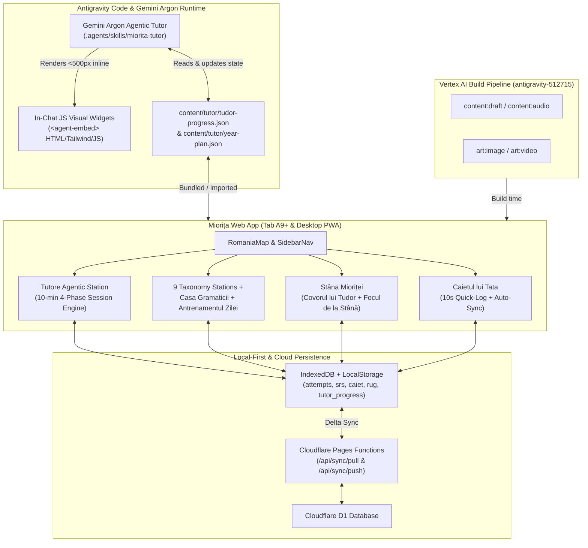
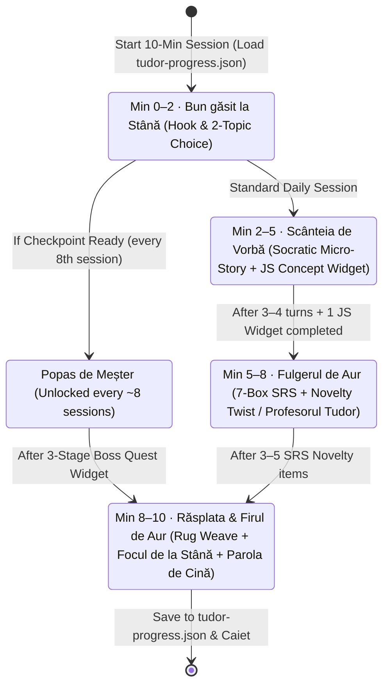

# Miorița: Technical Design

> **Version**: 0.2.0 · **Date**: 2026-10-28 · **Status**: ACTIVE (v0.1 Foundation Implemented · v0.2 Agentic Tutor & 1-Year Horizon)
> **Traces to**: [requirements.md](requirements.md) · [backlog.md](backlog.md) · [progress-tracker.md](progress-tracker.md)

---

## 1. System Architecture (v0.2 — Agentic Tutor + PWA Ecosystem)



### 1.1 Existing Foundation (Implemented in v0.1)
The codebase already implements a rich, offline-capable Romanian heritage learning environment:
- **Navigation & Shell (`src/main.ts`, `src/components/romaniaMap.ts`, `src/components/sidebarNav.ts`):** Storybook map of Romania with interactive pins, card view toggle, left vertical collapsible sidebar, mobile bottom nav, and Socratic mascot HUD (`src/components/mioritaHud.ts`).
- **9 Taxonomy Stations (`src/stations/*.ts`):** `gradinaCuGenuri` (`GEN`), `podulCui` (`CAS`), `vanatorulDeEnglezisme` (`CLQ`), `moaraCuArticole` (`ART`), `potecaLuiSa` (`SUB`), `fantanaPosesivelor` (`POS`), `targulDeNumere` (`NUM`), `ecoulDinMunte` (`CLI`), and `atelierulDeCulori` (`AGR`/`ORD`).
- **Theoretical & Visual Grammar School (`src/components/casaGramaticii.ts`):** *Școala din Sat* teaching the 5 *Meșteri ai Vorbirii* (Substantiv, Adjectiv, Verb, Pronume, Numeral), *Propoziția* (Subiect & Predicat), and *Detectorul Vizual de Cuvinte* bridging UK Year 4 SPaG with Romanian Grade 4.
- **Daily Review & Rewards (`src/stations/antrenamentulZilei.ts`, `src/stations/stanaMioritei.ts`):** 3-minute daily SRS quest + 10 comprehensive Quest Sets (`src/content/questSets.ts`), *Covorul lui Tudor* SVG woven rug, 7 starter cross-stitch motifs (`src/motifs/motifRenderer.ts`), and 6 *Lada de Zestre* folk badges.
- **Adaptive, Storage & Family Layer (`src/storage/*.ts`, `src/auth/familyAuth.ts`, `src/components/caietulLuiTata.ts`):** 3-tier non-punitive DDA (`AdaptiveEngine`: *🌱 Ucenic*, *🌿 Călător*, *⭐ Meșter Mare*), Leitner SRS (`srs.ts`), multi-child profiles with Parent PIN, `Caietul lui Tata` with dinner recast tips, and IndexedDB + Cloudflare D1 delta sync (`db.ts`, `syncEngine.ts`).

### 1.2 New in v0.2: Dual-Surface Gemini Argon Agentic Tutor
To give Tudor **10-minute byte-sized daily sessions** across a **1-year horizon** with **JS-based in-chat visuals**, **non-punitive gamification (≥2x/week)**, and **12 checkpoints**, v0.2 builds directly on top of the v0.1 foundation across two synchronized surfaces implemented in Antigravity code:
1. **Surface 1 — Antigravity Agentic Tutor Skill (`.agents/skills/miorita-tutor/SKILL.md` + `<agent-embed>` widgets):**
   - Runs directly in Antigravity powered by **Gemini Argon**.
   - Reads `content/tutor/tudor-progress.json`, `content/tutor/year-plan.json`, and `Caiet` entries at session start.
   - Conducts the 10-minute 4-phase Socratic session in Romanian, generating and embedding interactive JS visuals inline in the chat using `<agent-embed src="file:///.../widget.html"></agent-embed>`.
   - Writes session results, caught errors, SRS promotions, and Checkpoint completions back to `content/tutor/tudor-progress.json` and updates `.kiro/specs/progress-tracker.md`.
2. **Surface 2 — Full-Stage Main UI Agentic Tutor (`src/stations/tutoreAgentic.ts` + `src/components/tutorWidgets/*.ts`):**
   - **First-Class Main Stage Experience (No Corner Chat Box):** Mounted directly into `#stationRoot` inside `.miorita-stage-area` as the primary feature of the Main UI (alongside a hero banner on `RomaniaMap`, the #1 slot in `SidebarNav`, a central Carpathian pin, and a header *Focul de la Stână* pill).
   - Uses a full-width **Storybook Split/Stage Layout** on tablet/desktop (1920×1200 Tab A9+):
     - **Top Story-Arc Header:** 4-bead embroidered *Poteca de 10 Minute* progress band, active Season & Checkpoint (*Popas*), and live **🔥 Focul de la Stână** weekly badge.
     - **Left/Top Socratic Dialogue & Voice Deck:** Miorița's expressive card (≤2 sentences), **🔊 Ascultă** + **🐢 Mai rar (0.85×)** controls, large response choice pills, and the **"🎤 Spune tu!" Walkie-Talkie** voice bar.
     - **Right/Center Interactive JS Visual Canvas:** Full-stage interactive widget (`WordMorphSlider`, `CalqueZapper`, `BridgeTileSnap`, `RoleReversalDetector`, `GenderBasketMini`, `CheckpointTrailWidget`) where Tudor manipulates words directly on the main stage.

---

## 2. The 10-Minute Byte-Sized Session Engine (ADHD-Optimized)

### 2.1 ADHD Design Principles Applied
Children with ADHD (age 8, Year 4) experience rapid dopamine depletion during repetitive tasks, working-memory overload when given long explanations, and **Rejection Sensitive Dysphoria (RSD)** when penalized with red crosses or broken streaks. Every 10-minute session enforces five neurodivergent-friendly design rules:
1. **Micro-Phase Switching (2–3 min per phase):** The 10-minute session is divided into 4 distinct micro-phases so the interaction mode changes before boredom sets in.
2. **Choice-Driven Autonomy:** Every session begins with a binary choice of high-interest themes (e.g., *"Construim o cetate în Minecraft sau arbitrăm finala de fotbal a berbecilor?"*).
3. **Visual & Kinesthetic Anchor in Every Concept:** Abstract grammar rules (*genitive -ii*, *subjunctive să*, *postposed articles*) are never explained as dry text; they are immediately paired with an interactive JS widget where Tudor slides, zaps, or snaps words together.
4. **Role-Reversal Empowerment ("Profesorul Tudor"):** At least once per session, Miorița makes a silly English-interference error on purpose and asks Tudor to catch and fix it. Correcting the teacher produces an immediate confidence and dopamine boost.
5. **Visual Story-Arc Progress (Zero Ticking Clocks):** Progress is shown as a 4-bead embroidered shepherd's trail (*Poteca de 10 Minute*), never a counting-down digital timer that induces time anxiety.

### 2.2 4-Phase Session State Machine



| Phase | Time Window | Interaction Mode | Target Output |
|---|---|---|---|
| **1. *Bun găsit la Stână*** | Min 0–2 | Warm welcome (Warm Re-Entry if ≥4 days away) + 2-choice topic picker card | Selected theme (`minecraft`, `fotbal`, `animale`, `mister_carpati`, `scoala`, `legende`) |
| **2. *Scânteia de Vorbă*** | Min 2–5 | 3–4 Socratic dialogue turns steering into today's primary taxonomy category + **Inline JS Concept Widget #1** | 2–3 natural target utterances + completed interactive widget |
| **3. *Fulgerul de Aur*** | Min 5–8 | 3–5 due SRS items re-skinned into the chosen theme + **Inline JS Novelty Widget #2** (e.g., *Profesorul Tudor* or *CalqueZapper*) | Updated 7-box SRS cards + DDA tier adjustment |
| **4. *Răsplata & Firul de Aur*** | Min 8–10 | Effort celebration + **Inline JS Reward Widget #3** (*Focul de la Stână* + *Covorul lui Tudor* + 1-Year Trail) + *Parola de Cină* | Updated `tudor-progress.json`, new stitches, parent recast password |

---

## 3. JS-Based In-Chat Visuals & Micro-Interactions (`FR-VIS-001..004`)

### 3.1 Dual Rendering Architecture
Each interactive visual is designed as a compact (<500px height), touch-first (`≥48px` targets) JavaScript widget that works in both environments:
1. **In Antigravity Chat (`<agent-embed>`):** Generated as a self-contained `.html` artifact in `<appDataDir>/brain/<conversation-id>/` using the allowlisted Tailwind script (`https://www.gstatic.com/antigravity/web/dev/tailwindcss.min.js`), transparent body (`bg-transparent`), semantic theme variables (`bg-[var(--card)]`, `text-[var(--foreground)]`, `border-[var(--border)]`), and inline vanilla JS state handlers. Embedded inline via `<agent-embed src="file:///..."></agent-embed>`.
2. **In the Miorița PWA (`src/components/tutorWidgets/`):** Rendered as modular TypeScript DOM components inside the in-app Tutor chat stream (`src/stations/tutoreAgentic.ts`).

### 3.2 Widget Catalog & Pedagogical Mapping

| Widget ID | Name (RO) | Taxonomy / Pillar | Interactive JS Mechanic | Novelty / ADHD Hook |
|---|---|---|---|---|
| `W1` | **`WordMorphSlider`** (*Atelierul de Transformare*) | `CAS`, `ART`, `AGR` | Interactive slider / tap-morph that transforms an English-shaped phrase (*casa la bunica*, *am văzut câine*) into the inflected Romanian form (*casa bunic**ii***, *câine**le***), animating the suffix snapping into place with color-coded grammar highlights. | Kinesthetic slider + instant visual morphing of word endings. |
| `W2` | **`CalqueZapper`** (*Prinzătorul de Englezisme*) | `CLQ`, `ORD` | 3 floating speech bubbles from a confused English-speaking robot shepherd; Tudor taps the English calque word (*sunt 8 ani*, *sunt rece*, *face sens*) to "zap" it into golden Romanian (*am 8 ani*, *mi-e frig*, *are sens*). | Fast arcade tap-to-zap mechanic without timers or fail states. |
| `W3` | **`BridgeTileSnap`** (*Podul de Cuvinte*) | `SUB`, `NUM`, `POS`, `CLI` | A gap-bridge over a Carpathian stream; Tudor taps/snaps the missing connector tile (*să*, *de*, *pe*, *al/a/ai/ale*) into the plank so Miorița hops across with a bell chime. | Visual cause-and-effect: completing the grammar rule physically builds the bridge. |
| `W4` | **`RoleReversalDetector`** (*Profesorul Tudor*) | All (`GEN`..`ORD`) | Displays a postcard written by Miorița containing 1 deliberate interference mistake. Tudor taps the funny mistake word and chooses the correction stamp ("Ștampila de Meșter"). | Role reversal: Tudor gets to be the expert correcting Miorița! |
| `W5` | **`GenderBasketMini`** (*Trei Coșuri Rapide*) | `GEN` + Substantiv | Compact 3-item rapid sorter with *un–doi* (Voroneț blue), *o–două* (*ie* red), and *un–două* (sage green) baskets + interactive plural counter toggle (1 ➔ 2). | Instant color-coded sorting with 1-to-2 number morphing. |
| `W6` | **`CheckpointTrailWidget`** (*Harta de 1 An & Focul de la Stână*) | Progress & Gamification | End-of-session celebratory dashboard widget: lights up *Focul de la Stână* (weekly 2+ presence), animates new stitches onto a mini *Covorul lui Tudor*, and advances Tudor's token along the 12 Checkpoints of the 1-Year Carpathian Trail. | Tangible visual proof of effort and long-term journey progression. |

---

## 3.5 Bidirectional Voice Architecture & ADHD Guardrails (`FR-AUD-001..005`)

Supporting voice for an 8-year-old heritage speaker with ADHD introduces **5 specific technical and pedagogical risks** that the v0.2 design explicitly mitigates:

| Risk / Concern | Why It Matters for Tudor (8, ADHD, Heritage Speaker) | Architectural Mitigation in v0.2 (`src/audio/voiceRecognizer.ts` & `synth.ts`) |
|---|---|---|
| **1. STT Grammar Auto-Correction** | Browser `ro-RO` speech-to-text models often silently "fix" ungrammatical speech (*"vreau merg"* → *"vreau să merg"*) or drop short unstressed clitics (*l-*, *-o*, *să*, *de*), either hiding his error or falsely failing him. | • **Hybrid Voice + Visual Confirmation:** Voice is paired with visual word chips/sliders. For micro-suffixes (`ART` *-ul/-le*, `AGR` *-e/-i*), voice is complemented by a 1-tap visual confirmation (`WordMorphSlider`).<br>• **N-Best Alternatives Inspection:** Configure `recognition.maxAlternatives = 5` and inspect all 5 hypotheses—if any hypothesis matches the raw interference trap (`englishShape`), flag it for Socratic recast; if any hypothesis matches `authenticRom`, credit Tudor immediately! |
| **2. Mid-Sentence Cutoff (VAD Frustration)** | Standard voice assistants cut off after ~1s of silence. Bilingual ADHD kids frequently pause mid-sentence while searching for a Romanian word (*"Am fost la... umm... casa bunicii"*). Being cut off triggers frustration. | • **Walkie-Talkie Push-to-Talk (`🎤 Ține apăsat / Apasă Când Ai Terminat`):** Uses `continuous = true` + `interimResults = true` while the button is active, showing live animated words (*Unda Talăngii*) and only submitting when Tudor taps "Gata!" or releases. |
| **3. English Code-Switching (`Minecraft`, `football`)** | When Tudor says *"Am văzut un creeper în casa bunicii"*, strict `ro-RO` STT tries to transcribe *"creeper"* as random Romanian syllables. | • **Phonetic Loanword & Fuzzy Matcher:** Evaluates the **target grammar window** (e.g. does the transcript contain `casa bunicii` / `l-am văzut pe` / `vreau să`?) using normalized Levenshtein + token matching rather than requiring 100% exact full-sentence string equality. |
| **4. STT False Negatives & RSD (Rejection Sensitivity)** | If a child says the right Romanian phrase and the microphone mishears him, telling him "Try again" feels unfair and causes immediate disengagement. | • **"Blame the Mountain Wind" Fallback:** If STT fails to match, Miorița says: *"🌬️ Vântul de pe munte a suflat în microfon! Am auzit «...» — ai zis deja «casa bunicii»?"* with a green **[Da, asta am zis! 🐑]** button that awards full golden stitches immediately. |
| **5. CSP inside Antigravity `<agent-embed>` Widgets** | Antigravity `<agent-embed>` iframes block external network audio CDNs (`translate.google.com`), which would break external TTS URLs. | • **Zero-Network Native Speech & Web Audio in Widgets:** Inside `<agent-embed>` HTML widgets, voice output uses native `window.speechSynthesis` (`ro-RO` voice at `rate: 0.92` or `0.80` for 🐢 slow replay) + inline `AudioContext` acoustic synthesis, while the PWA also uses pre-rendered `/audio/*.mp3` clips. |

---

## 4. 1-Year Horizon Curriculum & 12 Checkpoints ("Popasuri de Meșter")

### 4.1 Curriculum Structure (`content/tutor/year-plan.json`)
The 1-year horizon spans **52 weeks** organized into **4 Seasonal Arcs** and **12 Checkpoints (*Popasuri*)**. Because presence is elastic (**≥2 sessions/week** expected, i.e. ~8–10 sessions per Checkpoint, ~100–120 sessions per year), progression is driven by **sessions completed + mastery readiness**, never by rigid calendar dates.

| Season | Weeks | Checkpoint (*Popas*) | Target Sessions | Primary Taxonomy Focus | *Casa Gramaticii* Bridge | Unlockable Motif / Badge |
|---|---|---|---|---|---|---|
| **I. Toamna în Satul Mioriței**<br>*(Fundația Vorbirii Curate)* | W1–W4 | **Popasul 1:** *Livada cu Genuri* | ~8 sessions | `GEN` (un/o, doi/două, neutru) | Moș Substantiv (Comun/Propriu, Gen, Număr) | Motif: *Roata Soarelui* · Badge: *Păstorul Cuvintelor* |
| | W5–W8 | **Popasul 2:** *Vânătoarea de Toamnă* | ~16 sessions | `CLQ` (am 8 ani, mi-e frig, are sens, de 3 ani) | Verbul *a avea* vs *a fi* în expresii | Motif: *Pomul Vieții* · Badge: *Vânătorul Iscusit* |
| | W9–W13 | **Popasul 3:** *Podul Bunicii* | ~24 sessions | `CAS` (casa bunicii, i-am dat mamei) + `ART` (-ul/-le/-a) | Substantivul articulat & posesia | Motif: *Coarnele Berbecului* · Badge: *Meșterul Podului* |
| **II. Iarna la Gura Sobii**<br>*(Legăturile Propoziției)* | W14–W17 | **Popasul 4:** *Poteca Zăpezii* | ~32 sessions | `SUB` (vreau/pot/trebuie + *să* + verb) | Morarul Verb (Persoanele 1–3 & Conjunctivul) | Motif: *Steaua Nordului* · Badge: *Călătorul Iernii* |
| | W18–W21 | **Popasul 5:** *Ecoul Carpaților* | ~40 sessions | `CLI` (l-am văzut pe..., i-am spus lui...) | Cascadorul Pronume (Personal & Politețe) | Motif: *Calea Rătăcită* · Badge: *Ecoul Carpaților* |
| | W22–W26 | **Popasul 6:** *Târgul de Iarnă* | ~48 sessions | `POS` (al/a/ai/ale) + `NUM` (≥20 + *de*) | Negustorul Numeral (Cardinal/Ordinal + *de*) | Motif: *Spicul de Grâu* · Badge: *Negustorul de Aur* |
| **III. Primăvara Meșterilor**<br>*(Gramatica Vie & Diacritice)* | W27–W30 | **Popasul 7:** *Atelierul Primăverii* | ~56 sessions | `AGR` + `ORD` (mașină roșie, scaune albe) | Zugravul Adjectiv (Acordul & Topica) | Motif: *Hora din Sat* · Badge: *Zugravul Vorbelor* |
| | W31–W34 | **Popasul 8:** *Cetatea Propoziției* | ~64 sessions | Mixed `CAS` + `CLI` + `SUB` in full clauses | Paznicii Porții (Subiectul & Predicatul) | Motif: *Brâul Carpaților* · Badge: *Străjerul Cetății* |
| | W35–W39 | **Popasul 9:** *Cronicarul cu Diacritice* | ~72 sessions | Reading & spotting **ș, ț, ă, â, î** + `ART` (`pe masă` vs `pe masa`) | Detectorul Vizual de Părți de Vorbire | Motif: *Floarea de Colț* · Badge: *Cronicarul Iscusit* |
| **IV. Vara pe Crestele Carpaților**<br>*(Povestitor Mândru)* | W40–W43 | **Popasul 10:** *Izvorul Proverbelor* | ~80 sessions | `CLQ` Tier 3 + authentic Romanian idioms (*a da o mână de ajutor*, *a-i părea rău*) | Timpurile Verbului (Ieri, Azi, Mâine) | Motif: *Vulturul de Munte* · Badge: *Meșterul Proverbelor* |
| | W44–W48 | **Popasul 11:** *Sfatul Bătrânilor* | ~88 sessions | Multi-trap repair (fixing 2 interference errors in one story) | Sinteza celor 5 Meșteri ai Vorbirii | Motif: *Coroana Mioriței* · Badge: *Boierul Vorbelor Curate* |
| | W49–W52 | **Popasul 12:** *Marea Sărbătoare a Stânei* | ~96+ sessions | Grand 1-Year Finale across all 10 categories at Tier 3 (*Meșter Mare*) | Tudor as Storyteller & Mentor to Miorița | Motif: *Covorul Domnesc Complet* · Badge: *Marele Meșter al Limbii Române* |

---

## 5. Data Model & Progress Tracking (`FR-TRK-001..003`)

### 5.1 Extended 7-Box SRS with Contextual Novelty (`src/storage/srs.ts`)
To support a 1-year learning horizon without repetitive flashcard fatigue:
- **Intervals:** `const INTERVAL_DAYS = [1, 3, 7, 14, 30, 60, 120];` (Boxes 1 to 7).
- **Non-Punitive Lapse Handling (`FR-SRS-005`):** When Tudor answers a Box 4–7 item incorrectly, `card.box = Math.max(2, card.box - 2)` instead of dropping all the way to Box 1.
- **Contextual Novelty Re-Skinning (`FR-SRS-004`):** Each SRS card tracks `lastContextTheme?: string`. When the Gemini Argon tutor selects a due card in Box ≥3, it preserves the grammatical target (`category`, `englishTrap`, `authenticRom`) but generates a fresh surface sentence using a different theme from `lastContextTheme`.

### 5.2 Canonical Progress Tracker Schema (`content/tutor/tudor-progress.json`)

```ts
export type TutorTheme =
  | 'minecraft'
  | 'fotbal'
  | 'animale'
  | 'mister_carpati'
  | 'scoala'
  | 'legende'
  | 'familie'
  | 'spatiu';

export type TutorWidgetType =
  | 'WordMorphSlider'
  | 'CalqueZapper'
  | 'BridgeTileSnap'
  | 'RoleReversalDetector'
  | 'GenderBasketMini'
  | 'CheckpointTrailWidget';

export interface WeeklyPresenceState {
  currentWeekIso: string;          // e.g. "2026-W44"
  sessionsThisWeek: number;        // 0..7+
  weeklyTarget: number;            // 2 (twice-weekly baseline)
  campfireState: 'unlit' | 'spark' | 'warm_fire' | 'super_sparks';
  totalWeeksMetTarget: number;     // cumulative weeks with ≥2 sessions (never resets!)
  goldenWoolBonus: number;         // earned from 3rd+ session in a week
}

export interface CategoryProgressRecord {
  category: TaxonomyId;
  tier: 1 | 2 | 3;                 // 1=Ucenic, 2=Călător, 3=Meșter Mare
  attempts: number;
  correct: number;
  srsBoxes: Record<1 | 2 | 3 | 4 | 5 | 6 | 7, number>;
  lastPracticedDate: string | null;
}

export interface TutorSessionLog {
  sessionId: string;               // "SES-2026-10-28-01"
  date: string;                    // "2026-10-28"
  durationMinutes: number;         // target ≤10
  season: 1 | 2 | 3 | 4;
  checkpointId: number;            // 1..12
  focusCategory: TaxonomyId;
  secondaryCategory?: TaxonomyId;
  themeChosen: TutorTheme;
  widgetsUsed: TutorWidgetType[];
  effortStitchesEarned: number;    // awarded for effort, retries & role-reversal
  wins: string[];                  // 1-2 specific things Tudor did great
  caughtErrors: Array<{
    said: string;
    correct: string;
    category: TaxonomyId;
  }>;
  parolaDeCina: string;            // fun phrase to say to Florin at dinner
}

export interface TudorTutorProgress {
  schemaVersion: 2;
  learnerName: 'Tudor';
  tutorModel: 'gemini-argon';
  horizonStartDate: string;
  horizonTargetEndDate: string;
  currentSeason: 1 | 2 | 3 | 4;
  currentCheckpointId: number;     // 1..12
  completedCheckpoints: number[];  // e.g. [1, 2]
  totalSessionsCompleted: number;
  totalMinutesPracticed: number;
  totalGoldenStitches: number;
  unlockedMotifs: string[];
  unlockedBadges: string[];
  presence: WeeklyPresenceState;
  noveltyState: {
    recentThemes: TutorTheme[];
    recentWidgets: TutorWidgetType[];
  };
  categories: Record<TaxonomyId, CategoryProgressRecord>;
  recentSessions: TutorSessionLog[];
}
```

### 5.3 Storage & Sync Integration (`src/storage/db.ts` & `src/storage/syncTypes.ts`)
- `MioritaDomain` is extended to include `'tutor_progress'`.
- `content/tutor/tudor-progress.json` serves as the repo-persisted source of truth for Antigravity IDE sessions and initial PWA hydration, while `localStorage.getItem('miorita_tutor_progress')` and IndexedDB store `tutor_progress` sync deltas across devices via `/api/sync/push` and `/api/sync/pull`.

---

## 6. Design System & Visual Guidelines for Tutor Widgets

All tutor visuals (both PWA and `<agent-embed>` inline widgets) adhere to the **"Rustic Romanian, light touch"** design system (`src/styles/tokens.css`):
- **Gender & Grammar Color Code (`NFR-UX-004`):**
  - Masculin / Substantiv: Voroneț Blue (`#2F5D8A`)
  - Feminin / Verb: *Ie* Embroidery Red (`#B23A2E`)
  - Neutru / Adjectiv: Sage Green (`#6E8B5E`)
  - Pronume / Rewards / Golden Stitches: Horezu Ochre (`#C8902E`)
- **Non-Punitive Feedback Tokens:**
  - Success / Stitch Added: `--sage` (`#6E8B5E`) + `--horezu-ochre` (`#C8902E`)
  - Gentle Retry / Hint: warm amber/ochre border, never red crosses or shake-buzzers.
- **Inline `<agent-embed>` Widget Constraints (`FR-VIS-004`):**
  - Must fit comfortably within a **500px vertical budget** (compact card layout, no `100vh` or `min-h-screen`).
  - Uses `<body class="bg-transparent text-[var(--foreground)] antialiased p-3">` and `<div class="bg-[var(--card)] border border-[var(--border)] rounded-xl p-4 shadow-sm">` so it blends natively into Antigravity Chat in both light and dark modes.

---

## 7. Testing & Verification Strategy
- **Vitest Unit Tests (`tests/`):**
  - Existing suites: `srs.test.ts`, `adaptiveArticleBank.test.ts`, `adaptiveCaseBank.test.ts`, `adaptiveDictionary.test.ts`, `adaptiveBanksExtended.test.ts`, `casaGramaticii.test.ts`, `familyAuth.test.ts`, `motifs.test.ts`, `questSets.test.ts`, `romaniaMapAndSidebar.test.ts`.
  - New v0.2 suites:
    - `tests/tutorProgress.test.ts`: validates 1-year horizon checkpoint unlocking (~every 8 sessions), non-punitive weekly presence (*Focul de la Stână* ≥2x/week logic, Warm Re-Entry trigger at ≥4 days absence, bonus *Lână de Aur* on session 3+), and novelty rotation rules.
    - `tests/srsYearHorizon.test.ts`: validates 7-box intervals (`1, 3, 7, 14, 30, 60, 120` days), gentle lapse step-back (`max(2, box - 2)`), and contextual re-skinning theme rotation.
    - `tests/tutorWidgets.test.ts`: verifies rendering and interaction state transitions for the in-chat JS widgets (`WordMorphSlider`, `CalqueZapper`, `BridgeTileSnap`, `RoleReversalDetector`, `CheckpointTrailWidget`).
- **Content & Spec Lint (`npm run content:lint`):** Ensures comma-below Romanian diacritics (`ș, ț`), valid taxonomy IDs, and schema compliance for `content/tutor/year-plan.json` and `content/tutor/tudor-progress.json`.
